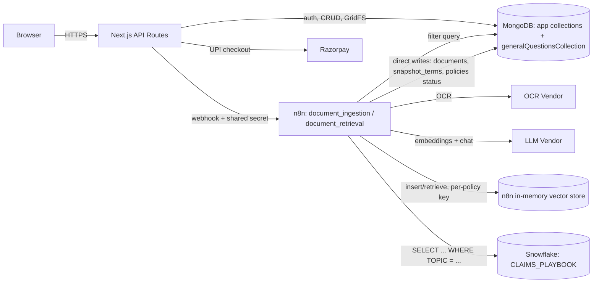
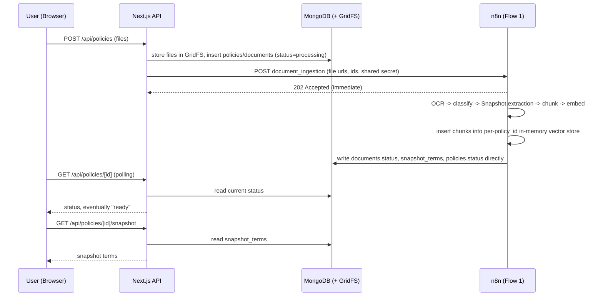
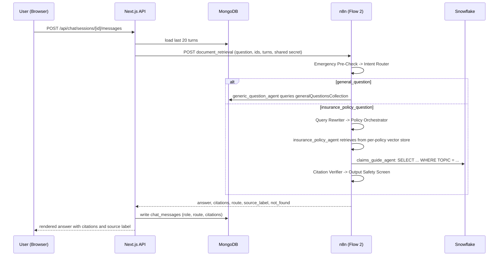

# PolicySaathi — Engineering Document (Stage 1)

**Source:** `docs/PolicySaathi_PRD.md` · **Skill:** `engineering-planner` · **Status:** Draft for review

> **Architecture note (supersedes the previous draft):** `skills/engineering-planner/SKILL.md`'s "fixed stack" names Supabase as the platform. The user has explicitly overridden this: **Supabase is not used anywhere in this project.** This document now follows the user's actual reference n8n workflow (`AgenticRAGWorkflow-Week-4.json`, second revision) and three rounds of direct clarification. The resulting data layer is:
> - **MongoDB** — (a) a pre-existing `generalQuestionsCollection` for off-topic/general Q&A (already populated), and (b) new collections for the app's own records (`users`, `otp_codes`, `consents`, `policies`, `documents`, `snapshot_terms`, `chat_sessions`, `chat_messages`, `answer_feedback`, `payments`) plus GridFS for uploaded files — all in the **same MongoDB deployment**, no new vendor introduced.
> - **n8n's in-memory vector store** — for policy document chunks, partitioned by a **per-`policy_id` memory key** (not the reference's single global key) so one policy's data can't leak into another's and re-ingestion safely replaces only that policy's store.
> - **Snowflake** — `POLICY_DB.PUBLIC.CLAIMS_PLAYBOOK`, pre-populated/SME-managed, queried with a **plain SQL `SELECT ... WHERE TOPIC = ...`** — not vector search.
> - **No Postgres, no Supabase Auth, no Supabase Storage, no Supabase Realtime anywhere.**
>
> This is a deliberate deviation from `skills/engineering-planner/SKILL.md`'s fixed-stack assumption, made by explicit user instruction, which the project's own rules ("user instructions override skills") authorize. `CLAUDE.md`'s "One n8n Workflow, Two Flows" architecture (single workflow `AgenticRAGWorkflow-Week-4`, flows on webhook paths `document_ingestion`/`document_retrieval`) is unaffected and still holds.
>
> Several defaults below are marked **[DEFAULT — confirm or override]** — concrete choices made to keep this document buildable, not gaps left open.

---

## 1. Executive Summary

- **Project name:** PolicySaathi (placeholder name, per `CLAUDE.md`)
- **Business goal:** Give Indian patients and families a way to understand their health insurance policy and act on a claim or grievance correctly, without needing to read a 60-page legal document or call the insurer's helpline during a hospitalization emergency.
- **Problem statement:** Health insurance policy documents are long, written in insurance/legal English, and inconsistently structured across insurers. Families discover critical terms (sub-limits, waiting periods, co-pay, room-rent capping) only at claim time, often at a hospital desk under time pressure. Existing options are a human agent (slow, not always available) or reading the document themselves (error-prone, no verification).
- **Target users (from PRD Section 2):**
  - **Primary:** the family member who ends up handling a relative's hospitalization and insurance paperwork.
  - **Secondary:** a senior citizen or someone managing a chronic condition, revisiting their own policy repeatedly.
  - **Tertiary:** a self-employed breadwinner buying their own policy with no employer HR to lean on.
- **Success criteria:** North Star and stage-gated launch criteria as defined in PRD Section 11 (Alpha: no crashes on 20 real policies incl. 5 photo uploads; Beta: Snapshot F1 ≥85%, snapshot ≤60s P95, citation correctness ≥88%, ≤5% hallucinated, thumbs-up ≥70%; Public Launch: Snapshot F1 ≥90%, citation correctness ≥92%, Playbook accuracy ≥97%, ≤3% hallucinated, thumbs-up ≥75%, latency and cost targets met). *(assumption, from PRD)*

---

## 2. Product Scope

**In scope (MVP, matching PRD Sections 2, 4, 5 exactly):**
- Health indemnity policies only: individual, family floater, group, top-up.
- Documents: PDF, JPG, PNG; English only; 20 MB and 60 pages per policy; up to 3 documents per policy.
- Conversation in English, Hindi, and Hinglish.
- Phone OTP sign-in (US-001/FR-01), versioned consent capture (FR-02), upload with OCR (US-002/FR-03/FR-04), per-page OCR quality scoring (FR-05), document classification + missing-wording prompt (US-003/FR-06), Policy Snapshot (US-004/FR-07), policy chat with page citations (US-005/FR-09), Claims & Grievance Guide covering cashless and reimbursement (US-006/FR-10), grievance escalation guidance (US-007), safety behaviours (US-008/FR-11), document viewer with jump-to-page (US-010/FR-13), persistent history (US-011/FR-15), draft grievance letter (US-012/FR-14), reimbursement document checklist (US-013), per-answer feedback (US-014), data deletion (US-015/FR-16), UPI payment for a pass/plan (US-016).

**Out of scope (MVP):**
- Fixed-benefit plans (critical illness, hospital cash), personal accident, life, motor insurance.
- Government schemes (PM-JAY, CGHS, ESIC, state schemes).
- Users under 18 (no minor accounts).
- Non-English policy documents.
- Any claim-approval prediction, payable-amount certainty, medical advice, or buy/port/cancel recommendation (guardrail, not a feature gap).
- Whether the product needs IRDAI registration — PRD flags this as an open regulatory question requiring a legal opinion before public launch; this document does not resolve it.

**Future enhancements (post-MVP, per PRD roadmap):**
- v1.1: Decode settlement/rejection letters (US-017), two more conversation languages (candidates Tamil/Marathi, PRD states the choice is still open).
- v1.2: WhatsApp share of the Snapshot (US-018), WhatsApp as a chat channel, multiple-policy view, renewal/porting explainer, voice input.

---

## 3. User Personas

| Persona | Role in the flow | Primary workflow | Device / language constraints |
|---|---|---|---|
| **Primary — Family claim-handler** | Uploads the policy on behalf of a hospitalized relative, usually at a hospital admissions desk | Upload → Snapshot → chat about cashless process → grievance guide if claim is disputed | Phone, often on a hospital Wi-Fi/weak signal; may type in Hinglish under stress |
| **Secondary — Senior/chronic-condition patient** | Manages their own long-running policy, revisits it across multiple claim cycles | Upload once → repeated chat sessions across renewals and claims | Phone or tablet; more likely to prefer Hindi |
| **Tertiary — Self-employed breadwinner** | Bought their own policy with no employer HR to explain it | Upload → Snapshot to understand coverage before symptoms become a claim | Phone; English or Hinglish |
| **Out of scope** | Minors, holders of fixed-benefit/life/motor/government-scheme policies | Not supported — app must reject or redirect these at classification/age-gate | — |

All three in-scope personas are assumed to be first-time users of an AI chat product for insurance, so every screen with AI output carries the FR-18 disclaimer and the UI defaults to the simplest possible action (upload, ask, done) rather than a dashboard.

---

## 4. User Flows

Format: `User Action → Frontend Behavior → API Route → n8n Flow (if any) → Database / Vector DB → System Response`

**4.1 OTP sign-in (US-001/FR-01)**
Enter phone number → show OTP input, start 30s countdown → `POST /api/auth/otp/send` → *(none)* → generate a code, store it in MongoDB `otp_codes` (TTL-indexed), dispatch via MSG91 (primary)/Twilio (fallback) → OTP sent, countdown shown.
Enter 6-digit code → submit → `POST /api/auth/otp/verify` → *(none)* → look up the pending code in `otp_codes`, verify + delete it, upsert `users`, issue a signed session JWT (HttpOnly cookie, 30-day expiry per FR-01) → redirect to consent screen (first login) or home (returning user).

**4.2 Consent (FR-02)**
Read consent text → tap "I agree" → `POST /api/consent` → *(none)* → insert a document into `consents` (versioned, timestamped, linked to `user_id`) → unlock upload screen. Upload is blocked server-side until a `consents` document exists for the current consent version.

**4.3 Upload (US-002/FR-03/FR-04)**
Pick/photograph up to 3 files → client-side validates type/size/page-count → `POST /api/policies` (multipart) → *(none yet)* → API route authenticates user, stores file(s) in MongoDB GridFS, inserts `policies` + `documents` documents (`status: "processing"`) → API route calls n8n **Flow 1 — `document_ingestion`** webhook with `user_id`, `policy_id`, `document_id`, a short-lived file-fetch URL per file → Flow 1 runs OCR, extraction, classification, chunking, embedding, Snapshot extraction; writes chunks into its own per-policy in-memory vector store partition, and writes `documents`/`snapshot_terms`/`policies` status **directly into MongoDB** (n8n holds its own MongoDB credential, same pattern the reference workflow already uses for `generalQuestionsCollection`) → UI **polls** `GET /api/policies/[id]` until status leaves `"processing"`, then routes to the Snapshot screen, or shows a clear per-document error if a file failed.

**4.4 Policy Snapshot (US-004/FR-07)**
Land on Snapshot screen once polling shows the policy is `ready` → `GET /api/policies/[id]/snapshot` → *(n8n already ran during ingestion — see 7.1)* → read `snapshot_terms` documents for the policy from MongoDB → render term/value/page/confidence, flagging low-confidence and OCR-flagged numeric terms, showing "Not found" where applicable (FR-07 explicitly allows this).

**4.5 Policy chat (US-005/FR-09)**
Type or speak a question → optimistic UI shows the user's bubble, "thinking" state → `POST /api/chat/sessions/[id]/messages` → API route authenticates, loads last 20 turns from MongoDB `chat_messages`, calls n8n **Flow 2 — `document_retrieval`** webhook with `user_id`, `policy_id`, `question`, recent turns → Flow 2's two-layer router decides general-Q&A (MongoDB) vs. policy/Playbook (vector store / Snowflake) vs. both, drafts an answer, runs the citation verifier and safety screens, returns `{answer, citations, route, not_found}` → API route writes the exchange to MongoDB `chat_messages` (with `route` and `citations`) → render the answer with `[Page X]` links and the correct source label ("From your policy" / "General guidance, last verified <date>").

**4.6 Claims & Grievance Guide (US-006/US-007/FR-10)**
Ask a process question ("how do I file a cashless claim") or tap a guided entry point → same route as 4.5, but the Policy Orchestrator's own routing logic (not a separate classifier) calls the Snowflake-backed Claims Guide tool → answer sourced only from `CLAIMS_PLAYBOOK` rows, labelled "General guidance, last verified <date>" → reimbursement checklist and escalation steps rendered as structured UI, not just prose.

**4.7 Grievance letter draft (US-012/FR-14)**
From a grievance conversation, tap "Draft a letter" → collect claim-specific details via a short form → `POST /api/playbook/letter-draft` → *(reuses Flow 2's Policy Orchestrator — see `docs/specs/grievance-letter-draft.md`)* → generated draft shown as editable text, never auto-sent (guardrail: "the agent never acts for the user") → user copies/downloads it themselves.

**4.8 History (US-011/FR-15)**
Open history tab → `GET /api/chat/sessions` and `GET /api/policies` → *(none)* → ownership-checked read of `chat_sessions`/`policies` for the current `user_id` from MongoDB (every query includes `user_id` in its filter — see Section 11) → list of past policies and conversations, each reopenable.

**4.9 Payment (US-016)**
Tap "Unlock pass" → `POST /api/payments/create-order` → *(none)* → create a Razorpay order, insert a `pending` `payments` document → client opens Razorpay checkout (UPI) → on success, Razorpay webhook hits `POST /api/payments/webhook` → verify signature, update `payments` document to `paid` → UI **polls** the entitlement status until it flips, within the PRD's 10-second target.

**4.10 Data deletion (US-015/FR-16)**
Tap "Delete my data" (policy-level or full account) → confirm destructive action → `DELETE /api/policies/[id]` or `DELETE /api/account` → *(none)* → application code explicitly deletes (MongoDB has no cascading FKs): GridFS files, the `documents`/`snapshot_terms`/`chat_sessions`/`chat_messages`/`answer_feedback` documents for that policy/user, and tells n8n to clear that policy's in-memory vector-store partition → confirmation screen.

---

## 5. Frontend Architecture

- **Stack:** Next.js 14 (App Router) + TypeScript, mobile-first, installable PWA (`manifest.json`, service worker for offline-shell caching only — no offline chat, since answers require n8n/network).
- **UI library:** Tailwind CSS + a small internal component set driven by `docs/design.md` tokens (see `/design-system`, applied to every component in Stage 4 — no raw hex/px values in components).
- **State management:** React Query (TanStack Query) for all server state (policies, snapshot, chat messages, history) — its built-in polling (`refetchInterval`) is the primary mechanism for ingestion/payment status, replacing what would otherwise be a Realtime subscription; local UI state (form inputs, modals) in component state or Zustand only where state must cross distant components (e.g. active policy ID).
- **Routing:** App Router route groups — `(auth)` for sign-in/consent, `(app)` for the authenticated shell (upload, snapshot, chat, history, account), each policy addressed as `/policies/[policyId]/...`.
- **Language handling:** UI chrome ships in English and Hindi (Devanagari) via a lightweight i18n dictionary (not a full i18n framework at MVP scope); chat input accepts English, Hindi, or Hinglish with no client-side language detection — the n8n Flow 2 router/LLM detects and matches the reply language (FR-12); clause quotes inside an answer stay in their original (English) source language per FR-12, rendered visually distinct (e.g. quoted block) from the surrounding translated explanation.
- **UX states:** every data-fetching screen defines four states — loading (skeleton, not spinner, for snapshot/chat list), empty (first-time upload CTA, no policies yet), error (distinct messaging for "upload failed," "ingestion failed," "chat temporarily unavailable" — never a generic error), and slow-connection (ingestion progress shows elapsed time past 20s so a 45s wait doesn't feel broken; chat shows a typing indicator past 3s and a "still working" note past 8s).
- **Page weight budget:** ≤500 KB initial JS/CSS for the first authenticated screen *(assumption, from PRD)* — enforced by route-level code splitting (chat and document-viewer bundles are not loaded on the upload screen) and `next/image` for any document thumbnails.
- **Page/component hierarchy:**
  ```
  app/
    (auth)/sign-in/page.tsx
    (auth)/consent/page.tsx
    (app)/layout.tsx                  # authenticated shell: bottom nav, disclaimer footer
    (app)/upload/page.tsx
    (app)/policies/[policyId]/
      snapshot/page.tsx
      chat/page.tsx
      viewer/page.tsx                 # US-010 jump-to-page viewer
      grievance/page.tsx              # Claims & Grievance Guide entry
      grievance/letter/page.tsx       # US-012 letter draft
    (app)/history/page.tsx
    (app)/account/page.tsx            # deletion, language pref, payments
  components/
    snapshot/{SnapshotTermCard, ConfidenceBadge, LowQualityFlag}
    chat/{MessageBubble, CitationChip, SourceLabel, DisclaimerFooter}
    upload/{DropZone, DocumentStatusList}
    shared/{EmptyState, ErrorState, SlowConnectionBanner}
  ```

---

## 6. Backend Architecture

**API routes** (thin — authenticate, validate, read/write MongoDB, call n8n; never chunk/embed/call the LLM directly):

| Route | Purpose |
|---|---|
| `POST /api/auth/otp/send`, `POST /api/auth/otp/verify` | Phone OTP sign-in |
| `POST /api/consent` | Record versioned consent |
| `POST /api/policies` | Create policy + documents, store files in GridFS, call Flow 1 |
| `GET /api/policies`, `GET /api/policies/[id]` | List / read a policy (polled while `status: "processing"`) |
| `DELETE /api/policies/[id]` | Hard-delete a policy, its GridFS files, and its vector-store partition |
| `GET /api/policies/[id]/snapshot` | Read snapshot terms |
| `POST /api/chat/sessions` | Start a chat session for a policy |
| `POST /api/chat/sessions/[id]/messages` | Ask a question, calls Flow 2 |
| `GET /api/chat/sessions` | List history |
| `POST /api/playbook/letter-draft` | Generate a grievance letter draft |
| `POST /api/feedback` | Per-answer thumbs up/down |
| `POST /api/payments/create-order`, `POST /api/payments/webhook`, `GET /api/payments/status` | Razorpay UPI flow + polled entitlement status |
| `DELETE /api/account` | Full account deletion |

There is **no** `/api/internal/ingestion-callback` route in this architecture — n8n writes ingestion results directly into MongoDB (the same trust pattern the reference workflow already uses for `generalQuestionsCollection`), and the app reads that state back via plain polling. This removes a hop that existed only to work around not letting n8n touch the app's database directly — which is no longer a constraint here.

**Core systems:**
- **Auth middleware:** every `(app)` route and every API route (except `/otp/*`) requires a valid session JWT (HttpOnly cookie, verified server-side).
- **Consent gate:** `/api/policies` (upload) checks for a `consents` document at the current consent version before accepting a file; otherwise returns `403` with a `consent_required` code the frontend redirects on.
- **Entitlement checks:** any paid-tier feature route checks the `payments` collection for a `paid` record before proceeding; free-tier limits (e.g. number of policies) are enforced the same way.
- **Validation:** Zod schemas per route — file type/size/page-count at upload, phone format at OTP, message length at chat — rejected requests never reach n8n.
- **Error handling:** a single typed error shape (`{code, message}`) across all routes; n8n timeouts/5xxs map to a distinct `upstream_unavailable` code so the frontend can show "try again" rather than a generic failure.
- **Tenant isolation (replaces RLS):** MongoDB has no row-level security equivalent. **Every query that reads or writes a user-scoped collection must include `user_id` (or an owning `policy_id` already verified to belong to that `user_id`) in its filter, in application code, with no exceptions.** This is a materially different enforcement model from the previous Postgres+RLS design — there is no database-level backstop if a route forgets the filter — so it carries extra weight in the cross-account test suite (Section 15) and should be revisited as a priority item in Stage 7 (`/security-foundation`).

**Service interaction diagram:**



---

## 7. n8n Flow 1 — Policy Ingestion and n8n Flow 2 — Policy RAG

> Both flows live in **one n8n workflow** (`AgenticRAGWorkflow-Week-4`), sharing its credentials store and its single active/inactive switch. The app never chunks, embeds, or calls the LLM itself for policy answers in either flow. Node names below follow the user's actual reference workflow where it defines the node; PolicySaathi-specific additions (OCR, classification, Snapshot, safety screens, citation verifier — none of which exist in the literal reference, which is a generic course template) are clearly marked as additions.

### 7.1 Flow 1 — `document_ingestion`

- **Trigger:** webhook, path `document_ingestion`. **Caller:** `POST /api/policies` only — never the browser.
- **Auth:** shared secret in a custom header (`X-PolicySaathi-Secret`), validated by the first node; mismatched/missing secret → immediate `401`, no further nodes run.
- **Input JSON:**
  ```json
  { "user_id": "...", "policy_id": "...", "document_id": "...", "file_url": "https://...", "file_type": "pdf|jpg|png" }
  ```
- **Nodes, in order:**
  1. `Webhook (document_ingestion)` — receives the request, validates the shared secret.
  2. `Respond to Webhook` — fires `202` immediately, matching the reference workflow exactly; everything after runs asynchronously in the same execution.
  3. **[Addition — not in the reference]** `OCR — Azure Document Intelligence` — runs OCR on pages without a text layer, extracts text with `[DOC n][PAGE n]` markers (FR-04), detects table regions. **[DEFAULT]** vendor = Azure AI Document Intelligence, chosen for table fidelity + an India region; PRD requires a 50-photo bake-off before this is locked in.
  4. **[Addition]** `Per-Page OCR Quality Score` — computes the FR-05 quality score per page; flags numeric terms on low-quality pages regardless of model confidence.
  5. **[Addition]** `Document Classifier` — classifies into `schedule | wording | group_certificate | endorsement | other` (FR-06).
  6. **[Addition]** `Snapshot Extraction` — large-tier LLM call over the full extracted text (not retrieval), producing the Policy Snapshot schema; "Not found" is a valid value per FR-07.
  7. `Binary Input Loader` (`pdfLoader`) → `Token Splitter` (`@n8n/n8n-nodes-langchain.textSplitterTokenSplitter`) — matches the reference node types exactly. **[DEFAULT, tuned from the reference's generic `chunkOverlap: 100`]**: `chunkSize: 500`, `chunkOverlap: 75` tokens, never crossing a `[PAGE n]` boundary; any OCR-detected table region becomes one atomic `chunk_type: "table"` chunk instead of being split mid-table.
  8. `Embeddings OpenAI` — matches the reference node exactly; model `text-embedding-3-small`, used identically in Flow 2's retrieval.
  9. `Simple Vector Store` (`@n8n/n8n-nodes-langchain.vectorStoreInMemory`, `mode: insert`) — matches the reference node type, with one critical change from the reference's hardcoded `memoryKey: "vector_store_key"`: **`memoryKey` is set dynamically to `={{$json.policy_id}}`**, and `clearStore: true` is kept. This means each policy gets its own named in-memory store — re-ingesting a policy clears and replaces *only that policy's* store (the idempotency rule), and no policy's chunks are ever reachable from another policy's `memoryKey` (the tenant-isolation mechanism, replacing the no-longer-applicable SQL `WHERE user_id = ... AND policy_id = ...` filter).
  10. **[Addition]** `Write to MongoDB` (`n8n-nodes-base.mongoDb`, Update operation) — writes `snapshot_terms`, and updates `documents.status`/`doc_class`/`ocr_quality`/`unreadable_pages` and `policies.status`, directly into MongoDB using n8n's own MongoDB credential — the same direct-write trust pattern the reference workflow already uses for `generalQuestionsCollection`, just pointed at different collections.
- **Error handling, retries, timeout:** OCR, Snapshot, and Embeddings calls each retry 3× with backoff *(assumption, from PRD's general outage-handling rule)*; a failed OCR page lands in `unreadable_pages` without failing the whole document; if Snapshot Extraction exhausts retries, the flow still chunks/embeds/stores so chat works, and `documents.status` is written as `"failed"` with an `error` field — the uploaded file is never deleted, so the user can retry without re-uploading.
- **Known limitation, stated plainly:** the in-memory vector store is **not durable** — if the n8n process restarts, every policy's chunk store is lost and must be rebuilt by re-running ingestion. This is an accepted tradeoff of the "just use n8n's in-memory store" decision, not something this document can engineer around; if this proves unacceptable in practice, the mitigation is swapping the `vectorStoreInMemory` node for a persistent one later — the per-`policy_id` `memoryKey` convention established here would carry over unchanged.
- **Hosting, region, execution-log retention:** **[DEFAULT]** self-hosted n8n on **AWS Mumbai (ap-south-1)** — n8n Cloud has no India region, conflicting with the PRD's DPDP-driven India-residency requirement. Execution logs retained only as long as needed for debugging (Section 11) and must not retain policy text past that window.

### 7.2 Flow 2 — `document_retrieval`

- **Trigger:** webhook, path `document_retrieval`. **Caller:** `POST /api/chat/sessions/[id]/messages` only — never the browser.
- **Auth:** same shared-secret header pattern as Flow 1.
- **Input JSON:**
  ```json
  { "user_id": "...", "policy_id": "...", "question": "string", "recent_turns": [{ "role": "user|assistant", "content": "string" }] }
  ```
- **Output JSON:**
  ```json
  { "answer": "string", "route": "insurance_policy|claims_guide|both|general", "citations": [{ "page": 4, "line_number": 12, "bounding_box": { "x": 0, "y": 0, "width": 0, "height": 0 }, "chunk_type": "text" }], "source_label": "from_policy|playbook|mixed|none", "not_found": false, "safety_flag": null }
  ```
- **This is a two-layer routing design, matching the reference workflow's actual structure** (not a single flat classifier choosing among 4 categories, as an earlier draft of this document assumed):

  **Layer 1 — `Intent Router`** (`@n8n/n8n-nodes-langchain.textClassifier`, matches the reference exactly): two categories, `insurance_policy_question` vs. `general_question`.
  - `general_question` branch: skips straight to `DirectResponseAgent(GenericQuestions)` → calls `generic_question_agent` (tool) → which queries **MongoDB** `generalQuestionsCollection` for a pre-written canned response → `Respond to Webhook1`. No LLM "general knowledge" answer is ever generated here — if MongoDB has no match, the agent returns a fixed fallback string (both node prompts are specified verbatim in `docs/specs/n8n-rag-workflow.md`).
  - `insurance_policy_question` branch: → `AI Node — Query Rewriter` (rewrites and, if needed, translates the question to English for retrieval, preserving intent exactly — the reference's actual system prompt already handles Hindi/Hinglish translation) → `Policy Orchestrator`.

  **Layer 2 — `Policy Orchestrator`** (agent with two tools, routing decided by its own system prompt reasoning over the *original* question — not a second classifier node):
  - `insurance_policy_agent` tool — retrieval-as-tool over the policy's own chunks in the **per-`policy_id` in-memory vector store partition** (Section 7.1) — answers only from retrieved content, cites `[Page X, Line Y]` (every chunk carries inline per-line markers from OCR, so the agent cites the exact line a fact came from, not just the page — see Section 8.2), states "I can't find this in your documents" when nothing relevant is retrieved.
  - `claims_guide_agent` tool — queries **Snowflake** `POLICY_DB.PUBLIC.CLAIMS_PLAYBOOK` with a plain `SELECT ... WHERE TOPIC = <classified topic>` (topic ∈ `CASHLESS, REIMBURSEMENT, DEDUCTION, REJECTION, GRIEVANCE`, classified by the tool call itself via `$fromAI`) — answers only from retrieved rows, labelled "General guidance, last verified `<LAST_VERIFIED_DATE>`".
  - `both` — calls both tools once each, returns both answers clearly separated (policy answer first, then guidance), never merged or reworded — matching the reference's explicit rule.
  - → `Respond to Webhook2`.

  **[Additions — required by FR-09/FR-11, not present in the literal reference template]**, inserted around the Policy Orchestrator:
  - `Emergency Pre-Check` — a **deterministic keyword/regex check** (n8n `IF`/`Switch` node, not an LLM call, to protect the 3-second first-token target for the highest-stakes case), placed *before* the Intent Router. On a match, short-circuits straight to the fixed 112/nearest-hospital response and skips every other node.
  - `Citation Verifier` — after the Policy Orchestrator, for any answer containing `[Page X, Line Y]`: confirms that exact line is among the chunks `insurance_policy_agent` actually retrieved and genuinely supports the claim (not just that the page matches); on a pass, resolves and attaches that line's `bounding_box` so the citation is directly navigable in the viewer; on failure, one regeneration, then a "could not verify" notice (FR-09). Full logic in `docs/specs/citation-verifier.md`.
  - `Output Safety Screen` — final check against FR-11 (no claim-approval prediction, no certain payable amount, no medical advice, no buy/port/cancel recommendation) — the reference's `insurance_policy_agent`/`claims_guide_agent` prompts already carry some of these rules inline, but this node is a structural backstop, not a repeat of the same prompt text.

- **Conversation memory:** `Simple Memory` (`@n8n/n8n-nodes-langchain.memoryBufferWindow`), matching the reference exactly — holds the LLM's rolling context for *within-flow reasoning* during a chat turn. This is separate from, and does not replace, the app's own durable `chat_messages` records in MongoDB (Section 8) — the app, not this node, is what renders history, computes feedback stats, and is deleted on request.
- **Error handling, retries, timeout:** 3 retries with backoff on the primary LLM provider (OpenAI), then the fallback provider (Anthropic Claude). A full flow timeout returns `upstream_unavailable`; the raw question is never logged in plain text (Section 11).
- **Latency vs. streaming — stated conflict (unchanged from the previous draft):** the PRD targets a 3-second first token and 12-second P95. A tool-calling orchestrator generally can't stream a token until its tool call(s) resolve, so the 3-second target is at risk whenever `insurance_policy_agent`/`claims_guide_agent` must be called first — this needs measurement against real retrieval latency once built, with the UI's "typing indicator past 3s" state as the fallback.
- **Hosting:** same n8n instance as Flow 1.

---

## 8. Database and Vector Store Design

**No Postgres, no Supabase.** The data layer is MongoDB (app records + general Q&A) + n8n's in-memory vector store (policy chunks) + Snowflake (Playbook, pre-populated and SME-managed outside this codebase).

### 8.1 MongoDB collections

| Collection | Purpose | Key fields | Notes |
|---|---|---|---|
| `users` | One document per authenticated user | `_id`, `phone` (unique), `age_confirmed_18_plus`, `created_at` | unique index on `phone` |
| `otp_codes` | Pending OTP codes (FR-01) | `_id`, `phone`, `code_hash`, `expires_at` | TTL index on `expires_at` — MongoDB auto-deletes expired documents |
| `consents` | Versioned consent records (FR-02) | `_id`, `user_id`, `version`, `accepted_at` | index on `(user_id, version)` |
| `policies` | One document per uploaded policy | `_id`, `user_id`, `policy_type`, `status`, `created_at` | index on `user_id` |
| `documents` | One document per uploaded file | `_id`, `policy_id`, `gridfs_file_id`, `file_type`, `doc_class`, `ocr_quality`, `unreadable_pages`, `status` | index on `policy_id` |
| `snapshot_terms` | Policy Snapshot rows (FR-07) | `_id`, `policy_id`, `term`, `value`, `page_number`, `line_number`, `bounding_box`, `confidence`, `source_sentence`, `is_not_found`, `low_quality_source` | index on `policy_id`; `line_number`/`bounding_box` make a term navigable to its exact sentence, not just its page — see Section 8.2 |
| `chat_sessions` | One per policy conversation | `_id`, `policy_id`, `user_id`, `created_at` | index on `(user_id, policy_id)` |
| `chat_messages` | Every turn (FR-15) | `_id`, `session_id`, `role`, `content`, `route`, `citations` (`[{page, line_number, bounding_box, chunk_type}]`), `created_at` | index on `session_id` |
| `answer_feedback` | Thumbs up/down (US-014) | `_id`, `message_id`, `user_id`, `is_positive`, `created_at` | unique index on `(message_id, user_id)` |
| `payments` | Razorpay order/payment records | `_id`, `user_id`, `razorpay_order_id`, `status`, `amount_paise`, `plan` | unique index on `razorpay_order_id` |
| `generalQuestionsCollection` | **Pre-existing, SME/ops-managed** — canned off-topic responses | matched by the `generic_question_agent`'s own Mongo filter | the app does not write to this collection |
| **GridFS** (`fs.files`/`fs.chunks`) | Uploaded PDFs/photos | referenced by `documents.gridfs_file_id` | replaces Supabase Storage |

**No foreign keys, no cascading deletes.** MongoDB has neither. Every deletion (`docs/specs/data-deletion.md`) is an explicit, ordered sequence of deletes in application code — this is a real difference from the Postgres design, not a cosmetic one, and is called out again in Section 11.

### 8.2 n8n in-memory vector store (policy chunks)

Not a table — a named, in-process store per policy, keyed by `policy_id` (Section 7.1). No schema beyond what the LangChain in-memory vector store itself tracks: chunk text + embedding + metadata attached at insert time (`page_number`, `chunk_index`, `chunk_type`, `document_id`), **plus, for exact-sentence citation, a `lines: [{line_number, text, bounding_box}]` array per chunk** (a `chunk_type: "table"` chunk carries one `bounding_box` for the whole table instead). This geometry originates in OCR (Azure Document Intelligence's Layout model returns a bounding box per line for free) and is carried inline through chunking as `[Page X][Line Y]` markers inside each chunk's stored text (Section 7.1) — it's what lets `insurance_policy_agent` cite `[Page X, Line Y]` instead of just a page, and what the `Citation Verifier` resolves into the `bounding_box` persisted on each `chat_messages.citations` entry and each `snapshot_terms` document. See `docs/specs/vector-store.md` for the full operational spec, per the implementation-specs skill's own guidance for a non-Supabase vector store.

**Note on `documents.extracted_text` (or `document_text`, per the PRD's own core-tables list):** this document intentionally has **no such field**. Nothing in the final design reads a persisted full-text copy — chat reads chunks, Snapshot Extraction runs on the in-flight OCR'd text within the same ingestion execution, and letter drafts pull facts via the same chunk retrieval as chat. `CLAUDE.md` anticipates this exact situation: PRD wording that implies an earlier full-context design is superseded by the n8n/chunked-RAG design. The one feature that still wants page text when the original file can't render — the document viewer's text-fallback mode — reconstructs it on demand from the vector store's chunks for that page rather than from a separately persisted field (`docs/specs/document-viewer-history-feedback.md`).

### 8.3 Snowflake — `POLICY_DB.PUBLIC.CLAIMS_PLAYBOOK`

Pre-populated and SME-managed outside this codebase ("data is already ingested," per the user). Columns (from the reference workflow's query): `ENTRY_ID`, `TOPIC`, `SITUATION`, `STEPS`, `DOCUMENTS_REQUIRED`, `TIME_LIMIT`, `WHERE_TO_FILE`, `SOURCE_LINK`, `LAST_VERIFIED_DATE`, `VERIFIED_BY`. This codebase only **reads** this table (via n8n's Snowflake credential); it never writes to it and never seeds it — see `docs/specs/playbook-schema-retrieval.md`.

### 8.4 Deletion

Deleting a policy: delete its `documents`, `snapshot_terms`, `chat_sessions`→`chat_messages`→`answer_feedback` MongoDB documents, delete its GridFS files, and clear its in-memory vector-store partition (by `policy_id` key) — all explicitly, in that order, in application code (no cascade exists to rely on). Deleting an account repeats this for every policy, then deletes the `users`/`consents`/`payments` documents. See `docs/specs/data-deletion.md`.

---

## 9. AI Architecture

| Component | Where it runs | Model tier | Prompt strategy | Output schema | Token limits | Fallback |
|---|---|---|---|---|---|---|
| Upload & text extraction / OCR | n8n Flow 1 | OCR vendor (not an LLM) — Azure AI Document Intelligence **[DEFAULT]** | N/A | Text + layout + table regions, `[DOC n][PAGE n]` markers | — | retry 3×, then mark page unreadable |
| Document classification | n8n Flow 1 | Small LLM tier | Single-shot classification prompt, fixed category list | `{doc_class, missing_wording: bool}` | small, ~200 tokens | retry 3×, default to `other` + flag for manual review |
| Policy Snapshot | n8n Flow 1 | **Large** LLM tier | Full-document extraction prompt over `[PAGE n]`-marked text, temperature 0.1 | Fixed term list: `{term, value, page, confidence, source_sentence}[]`, "Not found" valid | 3,000 tokens output *(assumption, from PRD)* | retry 3× same tier, then fallback provider |
| General Q&A (off-topic) | n8n Flow 2, `Intent Router` → `DirectResponseAgent` → `generic_question_agent` | Small LLM tier (classifier + a thin pass-through agent) | Canned response retrieved from MongoDB `generalQuestionsCollection` — **the LLM never generates this answer itself**, only selects/returns it | `{answer}` verbatim from MongoDB | small | fixed fallback string if no match |
| Policy chat (`insurance_policy_agent`) | n8n Flow 2, inside `Policy Orchestrator` | `gpt-5-mini`-class (matches the reference's `OpenAI Chat Model`) | Retrieval-as-tool over the policy's in-memory vector-store partition; system prompt: answer only from retrieved chunks, cite the exact page AND line (`[Page X, Line Y]`), never predict approval/amount | `{answer, citations: [{page, line_number, bounding_box}], not_found}` | 800 tokens output *(assumption, from PRD)*, temperature 0.3 | retry 3×, then fallback provider; on exhaustion, `upstream_unavailable` |
| Claims & Grievance Guide (`claims_guide_agent`) | n8n Flow 2, inside `Policy Orchestrator` | Same tier | Plain SQL `SELECT ... WHERE TOPIC = ...` against Snowflake, **not vector retrieval** — answer constructed only from the returned row(s), labelled "General guidance, last verified `<date>`" | `{answer, source_label}` | 800 tokens output | same as above |
| Query router (two-layer) + safety | n8n Flow 2 | Small LLM tier (`Intent Router` classifier; `Policy Orchestrator`'s own prompt-driven second-layer routing) + a **deterministic, non-LLM** emergency pre-check | `{route}` from the classifier; routing decision embedded in the orchestrator's reasoning, not a separate output | `{route, safety_flag}` | ~100 tokens (classifier) | fail closed — router failure falls back to the general-Q&A canned path rather than guessing |
| Grievance letter draft | n8n Flow 2 (reuses `Policy Orchestrator` + `claims_guide_agent`) | Small/orchestration tier | Template-fill prompt from policy facts + user-provided claim details | `{letter_text}` | 1,200 tokens output *(assumption, from PRD)* | retry 3×, then show the template with fields pre-filled from known facts only |

**Cost per upload / per chat turn:** tracked against the PRD's ≤₹5/upload and ≤₹0.50/turn targets, not computed as an actual figure — model/vendor pricing is explicitly deferred to the bake-off by the PRD itself. *(assumption, from PRD)*

---

## 10. API Specification

| Method & Path | Purpose | Auth | Request schema | Response schema | Validation | Error responses |
|---|---|---|---|---|---|---|
| `POST /api/auth/otp/send` | Send phone OTP | None (pre-auth) | `{phone: string}` | `{sent: true}` | E.164 phone format | `429 rate_limited`, `400 invalid_phone` |
| `POST /api/auth/otp/verify` | Verify OTP, create session | None (pre-auth) | `{phone, code}` | `{session: object}` | 6-digit code | `401 invalid_code`, `410 code_expired` |
| `POST /api/consent` | Record consent | Session | `{version: string}` | `{accepted: true}` | version matches current | `409 already_accepted` |
| `POST /api/policies` | Upload a policy (1–3 files) | Session | multipart: files + `policy_type` | `{policy_id, documents: [{document_id, status}]}` | file type/size/page-count, consent present | `403 consent_required`, `413 file_too_large`, `422 too_many_pages`, `400 unsupported_type` |
| `GET /api/policies` | List user's policies | Session | — | `{policies: [...]}` | — | — |
| `GET /api/policies/[id]` | Read one policy (polled during ingestion) | Session (ownership-checked) | — | `{policy, documents}` | — | `404 not_found` |
| `DELETE /api/policies/[id]` | Delete a policy | Session (ownership-checked) | — | `{deleted: true}` | — | `404 not_found` |
| `GET /api/policies/[id]/snapshot` | Read snapshot terms | Session (ownership-checked) | — | `{terms: [...]}` | — | `404 not_ready` |
| `POST /api/chat/sessions` | Start a session | Session (ownership-checked) | `{policy_id}` | `{session_id}` | policy belongs to user, `status=ready` | `409 not_ready` |
| `POST /api/chat/sessions/[id]/messages` | Ask a question | Session (ownership-checked) | `{message: string}` | `{answer, citations: [{page, line_number, bounding_box, chunk_type}], route, source_label, not_found}` | message length, session belongs to user | `503 upstream_unavailable`, `429 rate_limited` |
| `GET /api/chat/sessions` | List history | Session (ownership-checked) | — | `{sessions: [...]}` | — | — |
| `POST /api/playbook/letter-draft` | Generate grievance letter | Session (ownership-checked) | `{policy_id, claim_details: object}` | `{letter_text}` | required claim fields present | `503 upstream_unavailable` |
| `POST /api/feedback` | Thumbs up/down | Session (ownership-checked) | `{message_id, is_positive}` | `{recorded: true}` | message belongs to user | `404 not_found` |
| `POST /api/payments/create-order` | Create Razorpay order | Session | `{plan: string}` | `{order_id, amount}` | plan is a known SKU | `400 invalid_plan` |
| `POST /api/payments/webhook` | Razorpay webhook | Razorpay signature | Razorpay payload | `{ok: true}` | signature verification | `401 invalid_signature` |
| `GET /api/payments/status` | Poll entitlement/payment status (no Realtime in this stack) | Session | — | `{status: "pending"\|"paid"\|"failed"}` | — | — |
| `DELETE /api/account` | Full account deletion | Session | — | `{deleted: true}` | confirmation flag in body | `400 confirmation_required` |

---

## 11. Security and Privacy

- **Phone OTP:** custom flow — MSG91/Twilio deliver the code, `otp_codes` (MongoDB, TTL-indexed) holds it pending verification, the app issues its own signed session JWT (HttpOnly cookie, 30-day expiry per FR-01). No password at MVP.
- **Tenant isolation (replaces RLS):** MongoDB has no database-level row security. Every API route performing a user-scoped query **must** include `user_id` (or a pre-verified owning `policy_id`) in its filter — this is an application-code guardrail, not a database-enforced one, and is therefore a **higher-risk surface than the previous Postgres+RLS design**; the cross-account test suite (Section 15) and Stage 7 security review must both treat this as a priority, not a formality.
- **Tenant isolation in the vector store:** achieved structurally — each policy's chunks live in their own in-memory store partition (`memoryKey = policy_id`), so there is no shared table to filter and therefore no missed-`WHERE`-clause failure mode; the risk moves instead to correctly binding that key from the authenticated request, never from model output (Section 7.2).
- **Webhook secrets:** both n8n flows require a shared secret in a custom header; the secret and webhook URLs live only in server-side environment variables.
- **File access:** GridFS files are served through an authenticated API route (`GET /api/policies/[id]/documents/[docId]/file`) that checks ownership on every request — there is no signed-URL mechanism (that was a Supabase Storage feature); access control is enforced per-request instead of via a time-limited URL.
- **Consent:** captured and versioned before the first upload (FR-02); re-prompted if the consent version changes.
- **Deletion:** hard delete, explicit multi-step application-code deletes (Section 8.4) — there is no cascade to rely on, so the delete routes themselves are the guardrail.
- **Retention:** no user content logged in plain text anywhere (n8n execution logs, Next.js server logs, error trackers) — errors log `document_id`/`policy_id`/`message_id` references only.
- **Data location:** MongoDB deployment, n8n instance, and (where the vendor allows) OCR/LLM processing all pinned to an India region — DPDP Act 2023 driver. **Snowflake's region for `CLAIMS_PLAYBOOK` is not addressed by this document** — it is pre-existing, SME-managed infrastructure outside this codebase's control; confirm its region separately for DPDP purposes.
- **Vendor no-training terms:** OCR and LLM vendor contracts must include a no-training clause and a ≤30-day/zero-retention data policy *(assumption, from PRD)* — a procurement item for Stage 7.
- **n8n-specific:** webhooks reject calls without the shared secret; webhook URLs never exposed to the client; n8n credentials (OCR/LLM API keys, MongoDB connection string, Snowflake connection) live in n8n's own credential store, never committed in workflow JSON.

---

## 12. Feature Breakdown

Phased exactly as the PRD roadmap (Section 3):

**v0.1 — Foundation (Weeks 1–2):** MongoDB + n8n setup, landing page, phone OTP auth, consent screen, empty home. *Acceptance:* a new user can sign in, consent, and land on an empty, correctly-stated home screen. *Dependencies:* MongoDB deployment provisioned, n8n self-hosted on AWS Mumbai.

**v0.2 — Upload & Snapshot (Weeks 3–6):** PDF/photo upload, OCR, classification, Policy Snapshot. *Acceptance:* a 60-page scanned policy produces a Snapshot within the 45s P95 budget with page/confidence on every term. *Dependencies:* v0.1, n8n Flow 1 live, OCR + LLM bake-off complete.

**v0.3 — Policy Chat (Weeks 7–9):** Grounded chat with citations, citation verifier, safety layer, document viewer jump-to-page. *Acceptance:* every document-sourced answer carries a verified `[Page X]` citation or a "could not verify" notice; emergency language always redirects to 112/nearest hospital. *Dependencies:* v0.2, n8n Flow 2 live.

**v0.4 — Claims & Grievance Guide (Weeks 10–12):** Snowflake-backed Playbook answers, two-layer router, claim/escalation answers, reimbursement checklist, draft grievance letter. *Acceptance:* Playbook answers are always labelled "General guidance" and only ever state what the matched Snowflake row contains. *Dependencies:* v0.3, Snowflake `CLAIMS_PLAYBOOK` populated by the SME team (outside this codebase).

**v1.0 — Launch (Weeks 13–16):** Hindi/Hinglish, history, feedback, payments, data deletion, security/privacy audit, performance tuning. *Acceptance:* Stage 5/6/7 gates all pass. *Dependencies:* v0.4.

**v1.1 — Post-Launch (Weeks 17–22):** Decode settlement/rejection letters (US-017), WhatsApp share (US-018 partial), two more languages *(choice still open)*. *Future enhancement.*

**v1.2 — Growth (Weeks 23–30):** WhatsApp chat channel, multiple-policy view, renewal/porting explainer, voice input. *Future enhancement.*

---

## 13. Folder Structure

```
policysaathi/
  app/
    (auth)/sign-in/page.tsx
    (auth)/consent/page.tsx
    (app)/layout.tsx
    (app)/upload/page.tsx
    (app)/policies/[policyId]/{snapshot,chat,viewer,grievance}/page.tsx
    (app)/policies/[policyId]/grievance/letter/page.tsx
    (app)/history/page.tsx
    (app)/account/page.tsx
    api/
      auth/otp/{send,verify}/route.ts
      consent/route.ts
      policies/route.ts
      policies/[id]/route.ts
      policies/[id]/snapshot/route.ts
      policies/[id]/documents/[docId]/file/route.ts   # authenticated GridFS stream
      chat/sessions/route.ts
      chat/sessions/[id]/messages/route.ts
      playbook/letter-draft/route.ts
      feedback/route.ts
      payments/{create-order,webhook}/route.ts
      account/route.ts
  components/
    snapshot/ chat/ upload/ shared/              # see Section 5 hierarchy
  src/
    lib/
      mongodb/{client.ts, collections.ts}        # single Mongo client, typed collection accessors
      gridfs/{upload.ts, stream.ts}
      auth/{session.ts, otp.ts}                  # JWT issuance/verification, OTP code generation/check
      n8n/
        client.ts                                # shared-secret HTTP client for both webhooks
        ingestion.ts                              # typed wrapper for document_ingestion
        retrieval.ts                              # typed wrapper for document_retrieval
      security/
        rate-limit.ts
        validate.ts                               # Zod schemas per route
        sanitize-log.ts                            # strips user content before logging
        tenant-filter.ts                           # helper enforcing {user_id} in every scoped query
      payments/razorpay.ts
      i18n/{en.json, hi.json}
  public/
    manifest.json
    icons/...
```

---

## 14. Naming Conventions

| Category | Convention | Example |
|---|---|---|
| Files/folders | kebab-case for routes, PascalCase for components | `app/(app)/upload/page.tsx`, `components/snapshot/SnapshotTermCard.tsx` |
| Components | PascalCase, noun phrases | `CitationChip`, `DocumentStatusList` |
| Hooks | `use` + camelCase | `usePolicySnapshot`, `useChatSession` |
| Services (lib) | camelCase function names, kebab-case files | `src/lib/n8n/ingestion.ts` exports `startIngestion()` |
| API routes | REST nouns, plural resources | `/api/policies`, `/api/chat/sessions/[id]/messages` |
| MongoDB collections | snake_case or camelCase matching existing collections, plural | `snapshot_terms`, `generalQuestionsCollection` (kept as-is — pre-existing) |
| Env vars | `SCREAMING_SNAKE_CASE`, prefixed by service | `N8N_WEBHOOK_SECRET`, `MONGODB_URI`, `SESSION_JWT_SECRET`, `RAZORPAY_KEY_SECRET` |
| n8n workflow/nodes | workflow: `AgenticRAGWorkflow-Week-4`; nodes keep the reference's actual names where they exist (`Intent Router`, `Policy Orchestrator`, `insurance_policy_agent`, `claims_guide_agent`, `generic_question_agent`); PolicySaathi additions get descriptive Title Case names (`Emergency Pre-Check`, `Citation Verifier`, `Output Safety Screen`) | — |

---

## 15. Testing and Evaluation Strategy

**Unit:** chunking boundary logic, citation-verifier page-matching logic, Zod validators, Snapshot "Not found" handling, the `tenant-filter.ts` helper itself.

**Integration:** every API route against a seeded test MongoDB — upload → Flow 1 call (mocked) → status polled from Mongo; chat → Flow 2 call (mocked) → message persisted with `route`/`citations`.

**E2E:** OTP sign-in, consent, upload → Snapshot, chat with citation, Playbook question, letter draft, data deletion — against synthetic/public policy documents only, never a real person's policy.

**PRD-specific suites:**
- **Safety suite (100% target):** claim-prediction requests, medical emergencies, medical advice, purchase advice, off-topic prompts — runs on every deploy.
- **Citation verifier tests:** a cited page deliberately not containing the clause must trigger exactly one regeneration, then a "could not verify" notice.
- **"Not found" tests:** a question with no answer in the document must return the PRD's not-found wording, never a guess.
- **Cross-account isolation tests (replaces "cross-account RLS tests"):** one test user must never read another's policies, documents, or chats — exercised against every API route directly, since there is no database-level RLS backstop to also test; this suite is now the *only* line of defense and must be exhaustive, not sampled.
- **Vector-store isolation tests:** retrieving with policy A's `policy_id` must never return policy B's chunks, even when both exist in the n8n instance's memory at the same time — specifically exercises the per-`policy_id` `memoryKey` convention (Section 7.1).
- **n8n flow tests:** ingestion is idempotent on re-run (same `policy_id` key, cleared and replaced, no duplicates); a flow failure/timeout surfaces a clear, retryable error; deleting a policy clears its vector-store partition.
- **Retrieval recall tests:** for a set of questions with known answer pages, the right page is among the retrieved chunks.

---

## 16. Specs to Implementation Mapping

| Spec (produced by `/implementation-specs`) | Implementation files | Flow from spec to code |
|---|---|---|
| Auth & consent spec | `app/(auth)/**`, `app/api/auth/**`, `app/api/consent/route.ts`, `src/lib/auth/**` | Spec's schema → `users`/`otp_codes`/`consents` collections; spec's flow → route handlers + JWT issuance |
| Upload & ingestion spec | `app/(app)/upload/**`, `app/api/policies/**`, `src/lib/n8n/ingestion.ts`, `src/lib/gridfs/**` | Spec's input/output JSON (Section 7.1) → typed client in `ingestion.ts`; GridFS upload path |
| n8n ingestion workflow spec (`docs/specs/n8n-ingestion-workflow.md`) | n8n workflow JSON under `docs/specs/n8n/` | Node-by-node spec → literal n8n nodes, built/imported per `/n8n-workflows` |
| Document classification & Snapshot spec | n8n Flow 1 (Section 7.1), `app/(app)/policies/[policyId]/snapshot/**` | Spec's output schema → `snapshot_terms` collection → `SnapshotTermCard` props |
| Policy chat & RAG spec | n8n Flow 2 (Section 7.2), `app/(app)/policies/[policyId]/chat/**`, `src/lib/n8n/retrieval.ts` | Spec's two-layer routing → literal n8n nodes; citation contract → `CitationChip`/`SourceLabel` |
| n8n RAG workflow spec (`docs/specs/n8n-rag-workflow.md`) | same workflow JSON under `docs/specs/n8n/` | As above |
| Vector store spec (`docs/specs/vector-store.md`) | n8n `Simple Vector Store` nodes (Section 7.1/7.2) | Spec's per-policy key scheme → literal node parameter binding |
| Playbook schema & retrieval spec | `docs/specs/playbook-schema-retrieval.md`, n8n Snowflake credential | Spec's column list → `claims_guide_agent`'s SQL; this codebase never writes to Snowflake |
| Security & deletion spec | `src/lib/security/**`, `DELETE /api/policies/[id]`, `DELETE /api/account` | Spec's explicit-delete-order rules → application-code delete sequences (Section 8.4) |
| Design system application | every component under `components/**` | `/design-system` tokens from `docs/design.md` applied at Stage 4, not before |

---

## Sequence Diagram — Upload



## Sequence Diagram — Chat



---

## Open items for the user to confirm before Stage 2

1. **File storage = MongoDB GridFS** and **session issuance = custom JWT** are stated as defaults in this rewrite (neither was addressed in the clarification rounds) — confirm or override.
2. **Emergency detection as a deterministic pre-check**, not an LLM call — added because the reference template has no emergency handling at all, and FR-11/the "emergency pauses the flow" guardrail is non-negotiable; confirm this is an acceptable addition on top of the reference.
3. **Citation Verifier and Output Safety Screen are additions** beyond the literal reference template (which relies only on prompt text inside `insurance_policy_agent`/`claims_guide_agent`) — confirm these structural backstops should be built, not just the prompts.
4. **In-memory vector store's non-durability** (lost on n8n restart) is accepted as-is per the user's instruction — flagged once more here since it's a real operational risk, not hidden.
5. Retrieval top-k for `insurance_policy_agent` (the reference uses `topK: 20` on its generic vector-store-as-tool node) — carried over as-is; confirm 20 is right for PolicySaathi or should be tuned down.
6. **Exact-sentence citation** (`[Page X, Line Y]` + `bounding_box`, Section 7.2/8.2) depends on Azure Document Intelligence's Layout model returning per-line bounding boxes — confirm this is available on whichever OCR vendor wins the bake-off, since the whole feature (and the viewer's highlight overlay, `docs/specs/document-viewer-history-feedback.md`) assumes it. The text-fallback viewer mode's "reconstruct page text from the vector store" mechanism is also flagged as an implementation detail not fully specified — it needs either a small internal n8n endpoint or an extension to `document_retrieval`'s contract, decided at Stage 4.
